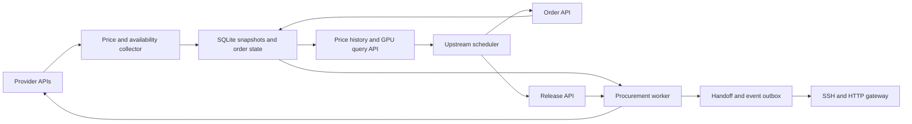
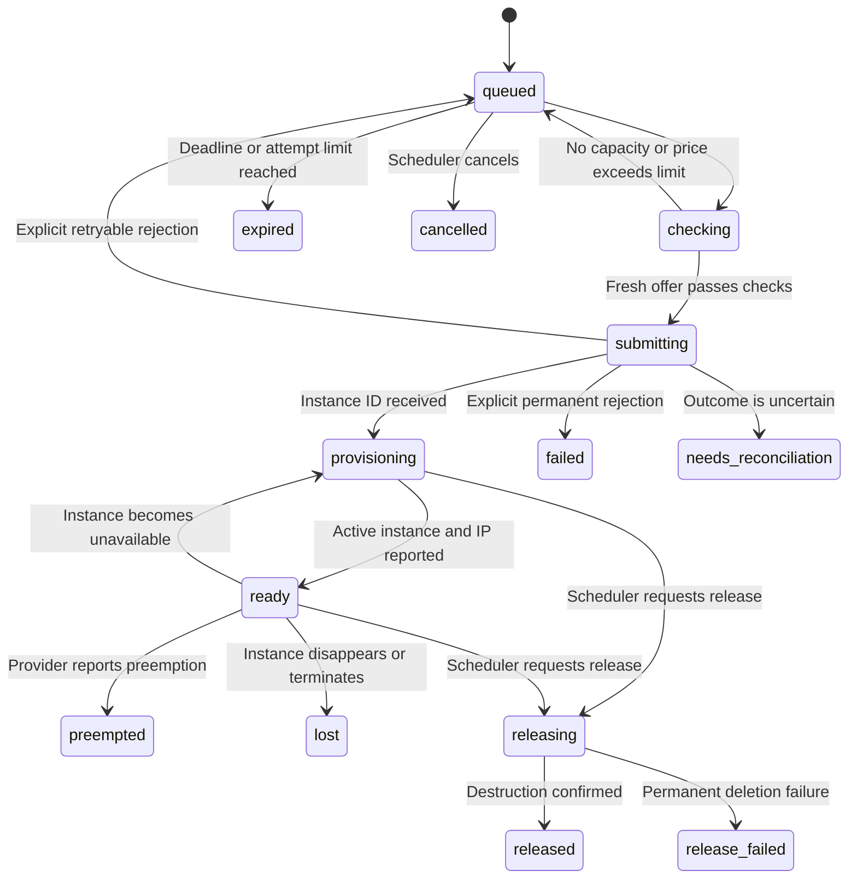

# Architecture

SpotOrderBot connects an upstream scheduler, GPU providers, and a gateway. The scheduler selects capacity and controls business budgets. The bot records prices, procures and monitors instances, and delivers connection metadata. The gateway verifies workload health and exposes usable capacity.

## Components

| Module | Responsibility |
|---|---|
| `providers.py` | Authentication, catalog normalization, launch plans, inspection, and deletion |
| `storage/` | Backend adapters for snapshots, atomic state changes, idempotency, recovery, and events |
| `service.py` | Collection, procurement, monitoring, release, and webhook delivery |
| `api.py` | Scheduler and gateway endpoints, authentication, and CLI workflow planning |
| `config.py` | Credentials, enabled providers, intervals, resource profile, and webhooks |
| `cli.py` | Service startup, standalone collection, and redacted configuration checks |
| `rentals.py`, `rental_models.py` | RFQ validation, durable server generations, backup and recovery lifecycle |
| `rental_aws.py`, `guest_agent.py` | Protected EBS disks, native snapshots/restore images, guest readiness and interruption reports |
| `storage/workflows.py`, `rental_api.py` | Versioned tenant-scoped workflow records, atomic events, and rental endpoints |

A storage interface persists collections, price snapshots, orders, and events in SQLite, MySQL, or DynamoDB. See [Storage Backends](storage.md) for configuration and backend-specific guarantees. There is no independent message broker. One asynchronous background loop collects catalogs, processes active orders, and delivers pending events. Backend-specific locks enforce one service per store; asynchronous locks serialize collection and order processing.

## Collection and discovery

Every 300 seconds by default, enabled adapters normalize catalog entries into offers containing provider, underlying cloud, SKU, region, market, GPU, resources, price, availability, and observation time. CPU-only entries are excluded. Spot and on-demand remain separate, even in the same region.

Offer identity includes the resource profile and market but excludes price and observation time. Prices are Decimal strings in USD per complete instance-hour. Per-GPU prices are derived for comparison; GB and GiB remain explicit.

Each successful complete collection appends snapshots. Latest queries use the most recent successful batch per provider; historical queries preserve earlier batches. Empty successful batches remove current offers. Failed collections preserve older data and expose errors. Available-only queries exclude offers older than the default 600-second freshness limit. Disabled providers are hidden from grouped latest prices and GPU discovery while history remains accessible.

## Procurement lifecycle

This section describes the original `/v1/orders` lifecycle. For an authorized
RFQ that requires automatic backup, replacement, and expiry, use the additive
[`/v1/rentals` workflow](rentals.md). Its current backend supports AWS Linux/EBS.

The scheduler selects an offer and submits a per-instance hourly price ceiling, a stable business idempotency key, a waiting deadline, launch settings, and optional inference connection metadata. Each order creates one VM. Matching replays return the original order; changed parameters with the same business key return a conflict.

Dry runs stay in `planned`. Live requests require the live ordering flag, service authentication configuration, a provider key, and `dry_run=false`.

The diagram shows principal transitions. Other release and reconciliation paths also exist. Before creation, the worker refreshes the catalog and checks availability, freshness, and price. Adapters enforce request spacing. The price ceiling is a submission check, not an atomic exchange limit order or total budget guarantee.

Waiting deadlines govern allocation before creation; they do not stop running instances. The scheduler remains responsible for releasing paid resources.

## Creation recovery

The worker commits `submitting` before sending a billable request. Timeouts, HTTP 5xx, malformed success responses, or interrupted requests can mean that creation succeeded without a returned ID. Those orders enter `needs_reconciliation` and are not automatically replayed.

On restart, interrupted `checking` orders return to the queue. Interrupted `submitting` orders require reconciliation. An operator locates the instance named `spotbot-{order_id}` and submits its ID. The bot verifies the name and resumes monitoring. Automatic account-wide reconciliation and native vendor idempotency are not implemented.

## Gateway delivery

An instance becomes `ready` when the provider reports it active with an IP. Its handoff includes SSH connection details and an optional HTTP inference URL. Private SSH keys remain in upstream key management. Instance readiness does not confirm container, model, network, or application readiness: HTTP metadata is marked `unverified`, and the gateway must validate health and authentication before routing traffic.

State transitions and handoff changes create events in the same database transaction. The outbox signs webhooks with HMAC-SHA256 over the timestamp and raw body, retries failures with exponential backoff, and records delivery results. Delivery is at least once. Receivers must verify signatures and timestamps, deduplicate event IDs, and read current state before acting on delayed events.

## Preemption and release

Preemption or disappearance revokes the available handoff and emits an event. The scheduler decides whether to purchase a replacement and resume a checkpointed workload. The bot does not automatically repurchase capacity.

That explicit scheduler boundary applies to `/v1/orders`. Protected rentals
automatically preserve their EBS disks, capture whole-server recovery points,
and create replacements within their accepted RFQ rules. They also enforce
expiry and retained-storage cleanup. Customer payment handling remains upstream.

Cancellation applies to queued or planned orders. Created instances require release: the worker requests deletion and polls until a terminal state or not-found response confirms destruction. Permanent deletion errors produce `release_failed`. Providers disabled for new acquisition can still have existing instances monitored and released.

## Integration boundaries

Lambda implements on-demand acquisition. Shadeform implements explicit on-demand and Spot requests. Vultr collects preemptible prices but rejects preemptible creation pending schema verification. TensorDock is disabled; its adapter implements dedicated-IP v2 on-demand requests.

SkyPilot is a potential future workload executor and is not invoked. SF Compute generates plans reflecting separate allocation, order fill, and instance lifecycles; commands are not executed.

## Logs and documentation

Application logs, CLI labels, API errors, and committed documentation use English. Runtime logs go to standard output/error; there is no rotating file logger. Failure logs contain provider names, order IDs, and error codes rather than keys or vendor response bodies.

Keep the README, this architecture document, and the configuration example as durable project documentation. Local research and integration reports, `.env`, databases, logs, caches, coverage reports, and build artifacts are ignored. Ignore rules do not remove files already tracked by Git.

Production expansion beyond the current singleton worker requires distributed coordination, tenant authorization, budget and quota policies, retention, automated reconciliation, and workload health integration.
